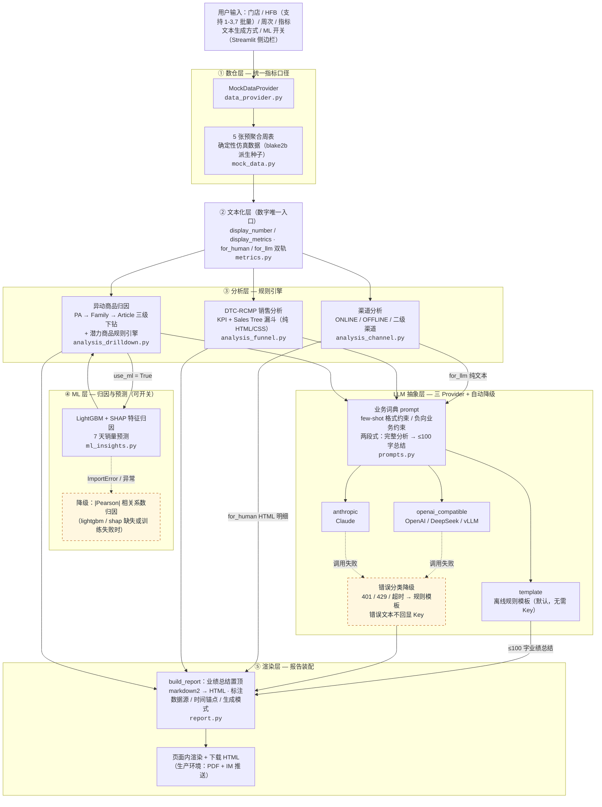

# 智能业绩诊断 Agent — 分析流程架构

五层诊断流水线的完整数据流与降级路径（与 `src/` 代码一一对应）。

## 读图要点（面试讲解动线）

1. **数字与文字分离**：所有数字只经过 ② `metrics.py` 一个入口，LLM 拿到的 `for_llm`
   文本里的数字也是代码算好后塞进去的——从架构上杜绝 LLM 算错数；
2. **双轨渲染**：③ 分析层每个模块同时产出人读 HTML 明细（`for_human`）和模型输入
   纯文本（`for_llm`），互不污染；
3. **两条降级链**（虚线）：LLM 无 Key / 调用失败 → 离线规则模板；LightGBM/SHAP 缺失
   或训练失败 → 相关系数归因。任意一条触发，报告都能完整产出，演示永不中断；
4. **ML 层可开关**：默认关闭（演示速度），开启后归因文本由
   `ml_insights.top3_features` / `forecast_next_week` 注入 ③ 的下钻结论中。
